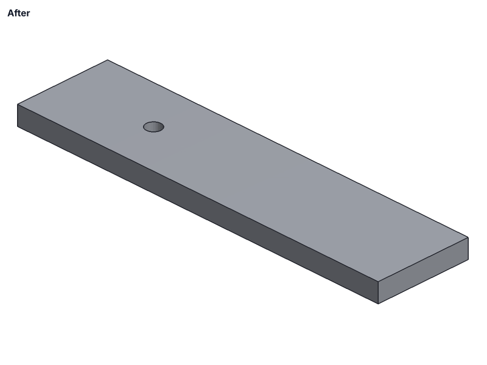
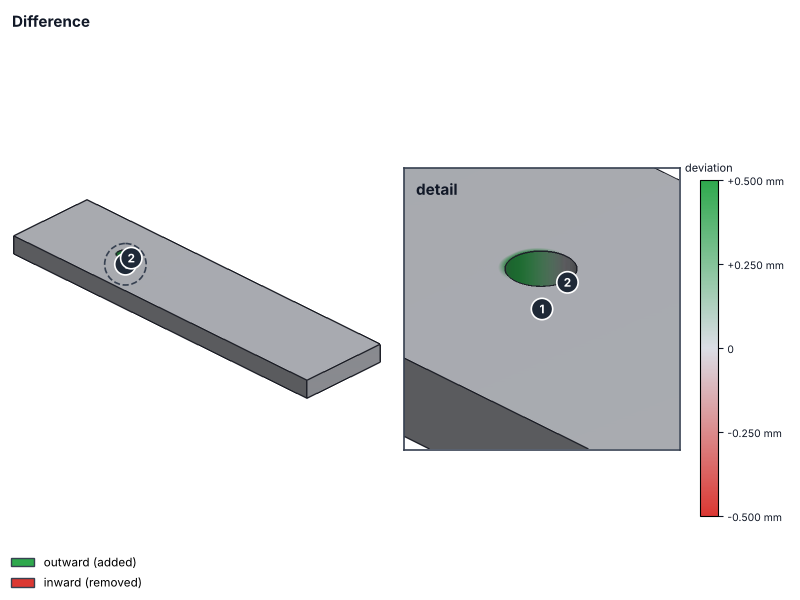
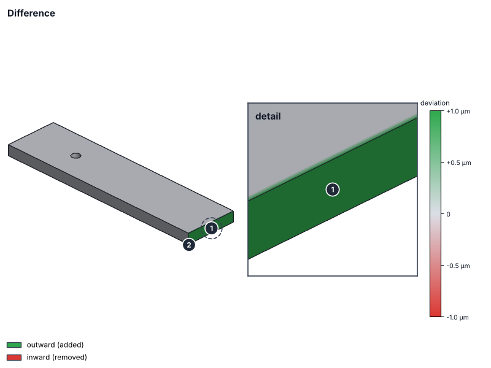

# theseus

See exactly what changed in a CAD file — which face moved, which hole grew, by how many
microns — without opening CAD software. `theseus` compares two versions of a STEP, IGES,
BREP, STL, 3MF, OBJ, PLY, OFF or GLB file geometrically, and reports every difference with
its location and size, down to the precision the files themselves can represent. It runs as
a CLI, or as an automatic, always-current comment on pull requests that touch CAD files.

| Before | After | Difference |
|:-:|:-:|:-:|
|  |  |  |

```
bracket.step (changed)
- Geometry: 3 differences (exact B-rep; detection limit: geometry kernel precision (0.1 nm)):
  - ① cylinder along Z Ø8.000 at (50.000, 25.000) → (50.500, 25.000) — axis moved 0.500 mm
  - ② 2 vertices moved, added or removed — largest 0.500 mm at (54.500, 25.000, 10.000)
  ...
```

That hole moved 0.5 mm without changing the part's volume or bounding box — a numbers-only
diff would call it unchanged. A **1 µm** change is still unmissable, with a zoomed detail:



Every PR comment starts with a summary of what changed, then one expandable section per file:

| File | Result | Largest difference | What changed |
|---|---|---|---|
| `bracket.step` | **changed** | 0.500 mm | cylinder along Z Ø8.000 at (50.000, 25.000) → (50.500, 25.000) — axis moved 0.500 mm |
| `mount.step` | moved | — | moved +5.000 mm X, shape unchanged |
| `plate.step` | micro-change | 1.0 µm | plane x = 200.0000 → 200.0010 — +1.0 µm |
| `housing.step` | identical | — | identical (re-export) |

Each file also gets a sheet of standard views (front, top, right, isometric) and an interactive
3D viewer — rotate, switch between before / after / overlay / difference, slice with a section
plane, measure, and click a finding to fly to it.

## Why

Reviewing a CAD file change on GitHub normally means downloading both versions and opening them
in AutoCAD/Fusion/SolidWorks just to see if anything actually changed. `git diff` on a STEP file
is thousands of lines of entity renumbering. theseus answers the reviewer's real questions —
did the geometry change, where, and by how much — straight in the PR, for anyone, with no CAD
software installed.

## Install

**As a GitHub Action** — drop this in `.github/workflows/theseus.yml`:

```yaml
name: theseus
on:
  pull_request:
    # [sS]-style classes because path filters are case-sensitive and CAD exports are often
    # uppercase (PART.STEP).
    paths:
      - '**.[sS][tT][eE][pP]'
      - '**.[sS][tT][pP]'
      - '**.[pP]21'
      - '**.[iI][gG][eE][sS]'
      - '**.[iI][gG][sS]'
      - '**.[bB][rR][eE][pP]'
      - '**.[bB][rR][pP]'
      - '**.[sS][tT][lL]'
      - '**.3[mM][fF]'
      - '**.[gG][lL][bB]'
      - '**.[pP][lL][yY]'
      - '**.[oO][bB][jJ]'
      - '**.[oO][fF][fF]'
permissions:
  contents: write        # images are stored on a separate `theseus-assets` branch
  pull-requests: write
jobs:
  review:
    runs-on: ubuntu-latest
    steps:
      - uses: actions/checkout@v4
        with: { fetch-depth: 0 }   # required — the diff needs the base commit
      - uses: arkapravopal04/theseus@v1
```

That's the whole setup. `fetch-depth: 0` is required: without full history the base commit
isn't in the checkout and the old version of each file can't be read. Every PR that touches a
CAD file gets one comment, which is updated in place on each push rather than re-posted. The
full report is also written to the workflow run's summary page.

`contents: write` lets theseus put the report images on an orphan `theseus-assets` branch (one
folder per PR, replaced on each push; your branches are never touched) so they show inline in
the comment. Without it — or on PRs from forks, whose token is read-only — the images, standard
views and 3D viewer are attached to the workflow run as the `theseus-images` artifact instead,
and the comment links there. Use `images: artifact` to always do that, or `images: off`.

Optional inputs (`with:`):

| Input | Default | |
|---|---|---|
| `images` | `inline` | `inline`: images in the comment (needs `contents: write`); `artifact`: only in the run's artifact; `off`: text only |
| `sensitivity` | `engineering` | When a difference counts as *changed* rather than a *micro-change*: `engineering` (10 µm or 0.1%), `fine` (1 µm or 0.01%), `exact` (anything above the detection limit) |
| `units` | `mm` | Length unit of formats that don't record one (STL, OBJ, PLY, OFF, BREP): `mm`, `cm`, `m`, `in`, `ft`, `um` |
| `timeout-seconds` | `300` | Time allowed to load one version of one file before it's skipped |
| `max-file-mb` | `50` | Skip files larger than this |
| `python-version` | `3.11` | |

CAD files in **Git LFS**: add `lfs: true` to the checkout step's `with:` and theseus fetches the
real content for both versions. The action also runs on `push` events (the report then goes to
the run summary only).

**As a CLI** — installs straight from GitHub, no cloning needed:

```bash
pip install git+https://github.com/arkapravopal04/theseus.git
```

```bash
theseus old.step new.step --out report.md --png preview.png
```

`--images DIR` writes the before / after / difference images, the standard-views sheet and the
interactive `viewer.html` into `DIR`, and the report links them.

`old` may be omitted to just report on a single (new) file. `--glb` also exports a `.glb` mesh —
commit it to GitHub for a free interactive rotate/zoom viewer, no CAD software needed. `--units in`
declares the unit of unitless formats; `--sensitivity fine|exact` tightens what counts as a change.
The exit status is 2 if a file can't be read or written.

## Precision

Every comparison states its **detection limit**: the smallest difference the two files can
actually represent. Above it, every difference is reported, with where it is. Below it,
differences are numerical noise, and a file reads as *identical (to within …)*. A sensitivity
threshold (10 µm / 0.1% by default) only decides whether a real difference is headlined as
*changed* or listed as a *micro-change* — it never hides one.

| Comparing | How | Detection limit |
|---|---|---|
| STEP/IGES/BREP ↔ STEP/IGES/BREP | every face matched by surface type and exact parameters (plane offset, cylinder axis and diameter, sphere, cone, torus); free-form faces by projection; every vertex by position | 0.1 nm (kernel precision), or coarser if the file declares or was written with less precision — the report says which |
| STL ↔ STL, same triangulation | per-vertex deltas | float32 storage: ~5 nm at 20 mm |
| mesh ↔ mesh, different triangulation | distance from each side's vertices to the other's surface, both ways | float precision on flat areas; on curves, each triangle's own chord error |
| STEP ↔ STL (or any B-rep ↔ mesh) | as above, measured exactly against the B-rep's true surfaces | as above |

Measured by the test suite (`tests/test_precision.py`), all detected and located:

| Change | Found as |
|---|---|
| one face of a 200 mm plate offset by 0.1 µm | `plane x = 200.00000 → 200.00010 — +0.1 µm` |
| a Ø8 hole enlarged by 2 µm | `cylinder along Z Ø8.0000 → 8.0020 … — Ø +2.0 µm` |
| a hole moved 0.5 mm sideways (volume unchanged) | `… (50.000, 25.000) → (50.500, 25.000) — axis moved 0.500 mm` |
| the whole part rotated 0.01° | `plane y = 0.000 — tilted 0.01° (far edge moves 35.0 µm)` |
| one STL vertex moved 1 µm | `surfaces differ by up to 1.0 µm near (…)` |
| re-exported STEP, same geometry | `identical (to within 0.1 nm, exact B-rep)` |
| STEP vs its own coarse STL export | identical — the STL's chord error is recognised as tessellation, not a change |

## Formats and units

| Format | Extensions | Geometry | Units |
|---|---|---|---|
| STEP | `.step` `.stp` `.p21` | exact (B-rep) | from the file, converted to mm |
| IGES | `.iges` `.igs` | exact (B-rep) | from the file, converted to mm |
| OpenCascade BREP | `.brep` `.brp` | exact (B-rep) | none recorded — assumed mm, or `--units` |
| STL | `.stl` (ASCII or binary) | triangle mesh | none recorded — assumed mm, or `--units` |
| 3MF | `.3mf` | triangle mesh | from the file, converted to mm |
| glTF binary | `.glb` | triangle mesh | metres (per the glTF spec), converted to mm |
| OBJ, PLY, OFF | `.obj` `.ply` `.off` | triangle mesh | none recorded — assumed mm, or `--units` |

Formats are recognised by content, not just extension: `PART.STEP`, a STEP file saved as
`part.step.bak`, and binary STLs whose header starts with "solid" all load correctly, and a
compiled `.obj` object file in the same repo is ignored rather than reported as a broken model.
Every report says where its units came from ("file units: inch, converted to mm" or "unitless
format, assumed mm").

## How it works

1. `git diff --name-status -M` finds changed CAD files between the PR's merge base and head,
   following renames (a renamed part is diffed against its own history).
2. Each version is read as a raw blob (`git cat-file`), with Git LFS pointers resolved.
3. Both versions of a file are loaded and compared in a child process with a timeout — a
   malformed file that crashes or hangs the geometry kernel becomes one "Skipped" line, not a
   failed run. Exact formats are loaded with OpenCascade (`OCP`); meshes with `trimesh`.
4. The geometry is compared face by face (or surface to surface for meshes — see
   [Precision](#precision)), alongside volume, area, bounding box and centre of mass. A part
   whose volume, area and moments of inertia are unchanged is tested for a rigid move: the
   old version, moved, must match the new one exactly before it's reported as "moved".
5. Images are rendered headless (VTK, on a private virtual display when there's no screen;
   a matplotlib fallback otherwise): added material in green, removed in red, or — for changes
   too small to see as material — a deviation map with a scale bar and a zoomed detail.
6. Everything is formatted as one markdown comment, edited in place on each push.

## Limitations

- **No native CAD formats.** No DWG, SLDPRT, IPT, F3D, CATPart or other proprietary format —
  there's no free reader for them. Export STEP alongside your native files.
- **Meshes are only as precise as their triangles.** A coarse STL cuts corners on curved surfaces;
  changes smaller than that chord error can't be seen in it (the report's detection limit says
  how small that is for each file). Flat areas keep full float precision.
- **Faces are compared, not features.** Reports name surfaces ("cylinder Ø8 along Z at …"),
  not design intent ("M8 clearance hole") — there's no feature tree in an exchange file.
- **Open geometry has no volume.** A mesh with holes or a surface-only STEP/IGES has no inside, so
  its volume and centre of mass are reported as n/a (with a warning) rather than a made-up number;
  the bounding box, area and previews still work. Inside-out mesh bodies are flipped and noted.
- **"Volume", not "mass".** CAD exchange files carry no density, so nothing here is a mass or
  weight calculation.
- **Fork PRs** get a read-only token, so the comment can't be posted; the report is still in the
  run summary, and the images in the run's artifact.
- **Inline images on private repositories** are linked from the `theseus-assets` branch; whether
  GitHub displays them in comments for private repos hasn't been verified yet. If they don't
  show, use `images: artifact`.
- **The 3D viewer loads three.js from jsDelivr**, so opening it needs an internet connection the
  first time.

## License

MIT for this project's code. The geometry kernel underneath (OpenCascade Technology, via the
[OCP](https://github.com/CadQuery/OCP) bindings) is **LGPL-2.1**.
